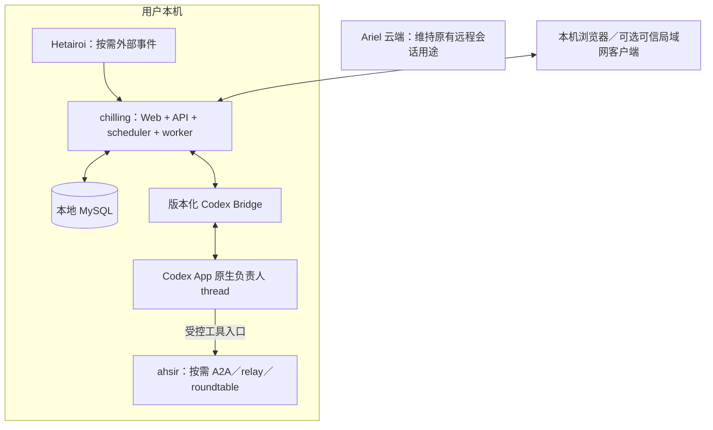

# 0001：本地任务看板、Codex 负责人及双向反馈

- 状态：Draft（2026-10-17：用户确认独立 chilling、本地部署；本文为重写后的详细行为，尚未实现）。
- 当前决定：任务看板、MySQL、调度、进展处理和反馈全部在本机，减少 Ariel 云端常驻资源。
- 保留需求：本机 Codex 原生负责人及官方模型、按需 ahsir、多任务消息订阅、反馈闭环、进展降噪、后台运行、未读和用户验收。
- 替代方案：Ariel 0088 云端可选任务模块草案。旧草案只保留历史，不再作为 Ariel 的实现任务。

## 1. 用户场景

用户在本地看板建立任务、交代目标与验收条件，点击开始后由本机 Codex 持续推进。用户可以在卡片中提交反馈、查看关键进展，也可以直接在 Codex App 中继续同一会话；相关变化回到同一任务。复杂工作由负责人按需委托 ahsir Agent，会诊与子任务结果汇回负责人。

看板默认列为：**待办／进行中／等待中／待验收／已完成**。卡片显示最新一句有效进展、负责人、最近确认时间、未读和需要用户处理的标记；详情显示任务信息、反馈讨论流、交付物和原生会话入口。

MySQL 选择保持不变，部署位置改为本地。chilling 是独立项目，首版不要求 Ariel 运行，不经公网 Relay 转发任务操作。官方模型推理继续使用本机 Codex 的官方账户与可用模型，不宣称完全离线推理。

## 2. 本地部署与资源边界

1. 首版是一个本地服务进程，内部划分 HTTP／Web、任务领域、scheduler／worker 和 Codex Bridge；不用远端 Server＋本地 Node 的双进程架构。
2. MySQL 与服务均运行在本机；不在云端创建任务库、任务 worker、摘要服务或看板托管。模型调用和用户选择的外部工具仍可能联网。
3. 默认 HTTP 仅监听 loopback。可信局域网访问需显式指定监听和认证配置，MySQL 不因开放看板而监听公网或直接暴露给浏览器。
4. 外网手机访问不是本次默认实施内容；用户是否要求首版包含外网访问仍待确认。不得为此默默增加公网 Relay、域名、隧道或任务云端存储。
5. 本机休眠、关机或 chilling 服务退出时，看板与后台处理不可用；本机恢复后从数据库和原生会话核对恢复。不能宣称本地服务拥有云端常驻可用性。
6. Ariel 与 chilling 可以独立启动。chilling 重启、停库和回退不重启 Ariel；Ariel 云端失联本身不阻断 chilling 的本地任务处理。

## 3. 显式启用与数据库故障

上轮明确要求的 `--enable-tasks` 保留在 chilling，用于显式开启任务链路；不再向 Ariel 增加该 flag。flag 名称与默认值是沿用的行为，不表示程序已经实现。

### 3.1 关闭模式

- `--enable-tasks` 默认 `false`，支持显式 `--enable-tasks=false`。
- 不读取或解析 `CHILLING_MYSQL_DSN`，不创建连接池、不调用 Open／Ping、不检查或迁移 schema。
- 不启动 task scheduler、投递、进展处理、Codex 任务订阅或 ahsir／Hetairoi 连接器，也不创建原生 thread。
- 仅提供进程存活／功能状态及“任务功能未开启”的静态页面；不展示可操作看板，不注册任务业务 API。
- 缺少、无效或不可达 DSN 均不影响关闭模式启动。编译可以包含 driver，运行环境无需因关闭模式安装或启动 MySQL。
- 不创建或删除任务数据；不改变已经存在的 Codex、Ariel、ahsir 或 Hetairoi 会话。

### 3.2 开启模式

1. 显式开启后，服务才读取私有环境变量 `CHILLING_MYSQL_DSN`。不提供密码命令行参数，不上传 DSN，不将凭据写入仓库或日志。
2. 缺失／格式错误的 DSN 明确报配置错误。DSN 合法但 MySQL 暂时不可达或 schema 不兼容时，HTTP 可显示任务不可用，readiness 失败，停止任务写入与派发，不回退到内存并冒充成功。
3. `/healthz` 表示进程存活，任务 readiness 单独表示依赖可用性；连接检查、重试和错误响应有界，不阻塞整个 HTTP 服务。
4. 反馈和任务只有在 MySQL 事务提交后才显示已保存。数据库失败保留浏览器输入，不展示虚假的已记录状态。
5. 数据库失联停止新 command。worker 已取得 command 不等于 native 已受理；尚未受理的操作须等任务状态／授权可核对后再提交，已精确受理的 native 执行不因数据库失联被误停止。
6. 改为关闭模式或停止 chilling，仅停止新的任务派发和跟踪，不自动中断 native turn、不删除 MySQL 数据或原生 thread。再次开启先核对再恢复。
7. migration 独立受版本管理，普通启动不执行破坏性 DDL。数据备份与恢复在本地运维说明中定义，不自动把私人任务备份到远端。

## 4. 状态归属与数据模型

| 数据 | 权威归属 |
| --- | --- |
| 任务目标、约束、验收条件、反馈、必要进展、已读水位 | chilling／本地 MySQL |
| command、outbox、执行关联、处理与汇报游标 | chilling／同一个本地 MySQL |
| thread／turn／item、完整正文、原生队列、权限和实际执行状态 | 本机 Codex |
| 下游 Agent、A2A context、Room、完整协作轨迹 | ahsir |
| 外部 source、handler 和采集去重状态 | Hetairoi |

首版不需要因跨公网交付再维护一套 Node 数据库或 journal。chilling 事务仍不能覆盖 native Codex 的副作用，outbox 和执行核对仍有必要。

逻辑实体至少包括：

- `Task`：身份、owner、目标、约束、验收条件、业务状态、waiting reason、version、本机工作目录、device 与 native thread 绑定。
- `TaskEvent`：任务内单调 seq、稳定 event ID、kind、actor、target、因果关系和可见性。
- `TaskMessage / Feedback`：用户内容、Agent 进展／结果、来源引用、native 身份、投递和回应关联；提交幂等键唯一。
- `Attempt`：依据的 task version／输入水位、native turn／queue／下游引用、执行观察和时间。
- `Command / Outbox`：稳定 command ID、操作、最小必要 payload、任务版本、lease、提交与 unknown 状态。
- `TaskReadCursor`：`(user_id, task_id)` 唯一，已读 seq 单调前进。
- `ProcessingCursor`：负责人已处理输入、原生事实已同步范围、进展覆盖范围分别保存。

不因已经在本地就镜像完整 Codex 会话库；MySQL 保存任务所需事实与摘要，本地完整执行记录按需从 native 来源读取。

## 5. 输入、输出与生命周期

### 输入与输出

建卡输入为标题、目标、必要背景、约束、验收条件和本机工作目录；任务不必是 Git 仓库。用户可开始、提交反馈、回答问题、暂停／继续、确认完成或显式重新打开。

输出为看板状态、必要进展、未读／needs_action、交付物、反馈投递状态及 Codex App 会话入口。错误区分未保存、未提交、忙、结果未知与状态待同步，不能只给一个笼统的失败。

### 生命周期

| 行为 | 结果 |
| --- | --- |
| 建卡且尚未开始 | 待办；反馈留档，不自动执行 |
| 用户点击开始 | 事务保存授权和启动意图，条件就绪后进入进行中 |
| 等 Codex 就绪、依赖、权限或用户决策 | 等待中，显示具体 reason |
| Bridge 断线但执行可能仍在运行 | 状态待同步，不判失败、不重复启动 |
| Agent 提交交付物与验收依据 | 待验收 |
| 用户确认结果 | 已完成 |
| 待验收时提交修改反馈 | 延续同一 thread，必要时回到进行中／等待中 |
| 已完成后补充反馈 | 可留档；显式重新打开后才恢复执行 |

暂停停止后续自动派发；中断当前 turn 是另一个精确 native 操作，必须等待核验结果。关浏览器、停服务、关闭 flag、断网均不等同于用户取消工作。未读、needs_action、业务列和 native runtime 状态独立保存。

## 6. 本机 Codex 负责人及 Bridge

1. 每个已启动任务绑定 `task_id + device_id + native_thread_id`，后续反馈默认继续同一 native thread；未启动任务尚无 thread。thread、turn、client message、command、attempt 和 RPC request ID 分别处理。
2. 负责人使用本机 Codex 和可核验的官方认证／模型，具体 model ID 从本机可用目录读取，不硬编码或自动改用第三方 provider。凭据只由本机 Codex 管理。
3. 验收必须实际确认：同一个 thread 能在 Codex App 中打开、查看持久化对话并继续；CLI 已退出、thread/start 有回执或使用官方模型均不能替代该证据。
4. 逐 thread system／developer 指令尚未证明可用。任务角色契约应包含目标、边界、验收、按需委派和证据汇报；具体注入方式通过 compatibility gate 确认，不改写用户全局设置。
5. 用户在 Codex App 的输入和相关输出同样进入任务事实。提交前核对 fresh owner、当前 turn、权限和待处理交互；手工输入优先，旧任务版本不能覆盖最新目标。
6. App、chilling、可能仍在线的 Ariel 共同面对同一 native owner。chilling 本地锁不等于跨客户端互斥；`TURN_BUSY` 延后，unknown 先核对，禁止两个客户端各自创建执行 owner 并声称安全。
7. 允许借鉴 Ariel 已验证的本机 Adapter，但不依赖 Ariel 公网 Relay，不直接跨 module import `Ariel/internal`，不把复制代码当成完成复用。共享公共 Adapter、独立版本化 Bridge 等方案须在实现前核验；若确需修改 Ariel 接口，另写其仓库内的独立规格。
8. 当前版本不兼容、Codex 不在线或模型无法核验时，显示等待／不可用；不能静默另开不在 App 可见的后端会话作为替代。

## 7. 消息订阅与子 Agent

每项任务有逻辑 inbox 和有序事件流，不要求每任务一个进程、一条网络连接或独立 MQ。负责人只处理已授权任务中的相关输入，不同任务并行受资源上限限制。

| 消息类型 | 行为 |
| --- | --- |
| 用户开始、已开始任务的反馈／问题回答 | 唤醒负责人 |
| 依赖变化、受信映射的 Hetairoi 事件、对应子任务结果 | 按目标和任务状态投递 |
| 定时检查 | 仅对已授权且未暂停、确有待检查工作的任务触发 |
| Agent 进展、摘要、展示变化 | 只更新看板，不再次唤醒自己 |
| 标题、排序、已读、心跳 | 不触发执行 |

每轮绑定输入水位和 task version；运行中的新反馈留到下一批，不能开启同一 thread 的第二个并行 turn。迟到结果不能吞掉新的反馈、暂停或目标变化。

通过受控 CLI／工具／MCP 为负责人提供 ahsir，按需使用 A2A、relay 或 roundtable；单 Agent 能完成时不强求多 Agent。工具接入、readiness／额度检查和结果身份须验证。ahsir 的结果汇回主 thread，不承诺下游全部对话自动在 Codex App 可见。

Hetairoi 不是必要运行依赖。任务由用户直接发起时可完全不用它；需要外部事件时才通过受信连接器接入。连接器不要求为每次本地调用重新构造事件。

## 8. 反馈与可靠执行

1. 用户提交反馈后，MySQL 在同一事务保存 Feedback、TaskEvent 与 Outbox；提交成功才显示“已记录”。同一客户端幂等键重试返回原反馈。
2. 本机 worker 从 outbox 获取 command，通过已核验的 Bridge 向同一 native thread 提交；忙时等待或使用验证过的原生队列。
3. 展示“待投递／已提交 Codex／已回应”，并可附等待、失败、待核对状态。数据库保存、worker 取到、原生受理、负责人回应是不同事实。
4. 原生受理以 exact thread／turn／client-message 或 queue 身份证明。“已回应”要明确关联 feedback IDs；不能凭任意后续回复清空全部反馈。
5. 回执丢失、进程崩溃、超时后先进入 unknown 并核对。查不到记录不自动证明没有执行；不能盲目重建 thread 或重发首条消息。
6. 同机部署也有 MySQL 提交与 native 执行之间的崩溃窗口；采用 outbox 重试与业务核对，不声称跨系统 exactly-once。
7. 数据库恢复或服务重启时，先根据稳定 command／attempt／native 身份恢复状态，再执行新工作。旧 lease、旧 owner 和迟到事件不得覆盖新事实。
8. 暂停任务的反馈留档等待，已完成任务需显式重新打开。变更任务目标和取消／停止要求不被普通反馈批次延迟覆盖。

## 9. 后台跟踪与进展降噪

1. task worker 独立于浏览器生命周期持续跟踪已授权任务，不能依赖页面打开或 Web controller 的短时暖保留。
2. 通过 exact thread／turn／item、消费水位及 native snapshot 核对更新；Bridge 断线或程序恢复先核对，不按标题、正文相同或更新时间猜身份。
3. 有效进展从本机 Codex 回写本地 MySQL，再推送看板；App 里直接继续对话产生的相关进展也要处理。
4. 默认每 10 分钟检查一次可汇报变化，可配置；成果、阻塞、待决问题和交付及时发布。无新事实不刷回复，不把心跳当进展或编造百分比。
5. 程序负责定时、队列和恢复，prompt 负责表达。长 turn 期间可利用已记录阶段事实汇报，不强行向同一忙碌负责人插入新 turn。
6. 需要模型归纳时使用明确配置的本机官方 Codex 路径，与负责人写操作串行／隔离；不增设云端摘要模型。
7. 每份摘要保留覆盖水位和来源，区分已验证成果、判断、阻塞、下一步；目标、约束、验收条件和未决反馈保持结构化，不被摘要压缩删除。
8. 原始工具流水、重复尝试和完整日志按需从本地详情查看。只有已有事实才能写进进展；事实不可得时显示待同步与最近确认时间。

## 10. 未读、待处理与验收

1. 本地服务用 MySQL 保存 `(user_id, task_id, read_seq)`；跨本机浏览器及获准局域网客户端共享状态。用户身份稳定，不随浏览器 session 或设备变化。
2. 面向用户的 Agent 回复、有效状态变化和待决事项产生未读；原始日志、心跳和该用户自己的编辑不产生新未读。
3. 只有身份匹配、页面可见、内容已渲染且位于最新位置时，ack 实际看到的 seq。点开卡片、后台加载、阅读旧历史或同步失败都不能清除。
4. ack 与新进展并发时，只清已看到的部分；旧 ack 不回退水位。同一任务卡片、筛选结果和详情共用 read-state。
5. Agent 已处理水位、进展覆盖水位与用户 read cursor 分离。读过问题不等于解决问题，读过交付物不等于验收。
6. Ariel 原会话已有的浏览器未读不迁移、不冒充 chilling 的 read-state；两者可以独立存在。

## 11. 本地数据、访问与故障边界

TaskStore、反馈、摘要和后台状态留在本机，不自动同步到 Ariel、远端数据库、公共日志平台或云备份。私人知识库不 push／上传，凭据不入仓库。本地摘要可使用当前任务获准读取的材料，不机械沿用旧云部署方案的出站摘要限制；如未来增加云同步，必须另行定义可执行的数据策略。

官方 Codex 模型调用及用户授权的外部工具仍遵循原有访问方式，不能把“本地 TaskStore”表述为所有计算与通信都离线。chilling 默认没有向 Ariel 导出任务内容的路径。

loopback 以外的看板访问必须显式开启认证与受限监听；任务 API 不能默认成为无需认证的局域网执行入口。具体远程访问方式、账号与部署说明在用户确认需要后单独定义。

MySQL 连接、API 分页、事件 payload、任务并发和 native 跟踪集合设上限。本机断网、Codex 不可达、数据库不可达、任务版本冲突和 native unknown 分别处理；不能用持续轮询或无限开进程掩盖故障。

## 12. 待验证能力与隔离 gate

以下不是已有功能，需对当前安装版本独立验证：

1. 原生首 turn 流式执行、终态持久化和 Codex App 同 thread 接管。Ariel 的历史证据仅覆盖特定版本首 turn 终态后接管，不保证首轮进行中即可在 App 实时显示。
2. 逐任务指令注入、官方模型／provider 的选择和读回、用户从 App 改设置后的行为。
3. App UI、chilling 与 Ariel 同时操作的真实竞态、原生队列身份、owner fencing 以及 unknown 核对。
4. 无浏览器时后台订阅、程序重启／本机恢复、数据库停机后不丢进展且不重复执行。
5. ahsir 工具桥接与外部事件连接器；不导入兄弟仓库 internal，不把未实现的事件出口标成可用。

试验只在隔离目录／fixture thread 中进行，不重启用户正在使用的 Codex 或向真实任务发送测试内容。失败则暂停对应任务能力并显示明确原因；不换 provider、不猜 thread、不盲目重发。

## 13. TDD 与验收

完整规格获批后才进入 red → green → refactor。文档生成、依赖安装或接口存在都不等于功能通过。

1. **关闭模式**：数据库工厂、Ping、migration、worker、Codex 任务订阅和外部连接器均零调用；缺失／坏／不可达 DSN 不影响关闭模式。
2. **本地独立性**：不用公网 Ariel、不启动云资源，chilling 能处理本地任务；测试时让 Ariel 不可达，不能影响看板与本机跟踪。
3. **MySQL**：隔离真实数据库验证 task／feedback／outbox 原子性、幂等、版本冲突、lease 恢复和 read cursor；不得只用 mock 代替事务验证。
4. **副作用窗口**：首建 thread、首发回执丢失、worker 崩溃、停库分别覆盖 native 未受理／已受理；不存在盲目补建或跨系统 exactly-once 的假设。
5. **反馈闭环**：看板提交留档，进入同一个 native thread，排队／unknown／明确回应均按身份转换；运行中新反馈和用户 App 输入不被旧结果吞掉。
6. **后台同步**：所有浏览器关闭后仍能回写进展；Bridge 断开、服务重启及本机恢复后按水位补齐且不重复派发。关闭 flag 保留原生执行和数据库内容。
7. **降噪与未读**：原始日志不刷屏，无变化不发报告，关键事项及时回写；后台／旧历史不清未读，跨端 ack 与新消息并发不误清，needs_action／待验收独立。
8. **数据边界**：私有任务、工具输出和数据库配置不流入 Ariel／第三方日志／云备份；默认不监听公网，浏览器不能直接访问 MySQL。
9. **真实 native**：实际验证 App 同 thread 可见与继续、官方模型、手工竞争和队列语义；未通过的能力标记 unverified／不可用。
10. **真实浏览器**：隔离 API／事件 fixture 覆盖桌面和手机 viewport 的列布局、反馈输入、草稿保留、状态与标记，断言交互和几何并检查截图。物理 iPhone／Safari 单独记录，不以 Chromium 模拟冒充。
11. 运行与改动风险匹配的 Go 测试／race／vet、Web 单元、production build 和浏览器回归；新增失败或变更才扩大测试范围。

## 14. 实施阶段与回退

1. 本地装配、`--enable-tasks`、依赖配置和无 DB 模式；不安装或启动用户未要求的服务。
2. MySQL 任务／反馈／outbox／read-state，以及隔离 fixture 看板。
3. 通过 native gate 的单任务负责人、反馈投递、无浏览器时的进展跟踪。
4. 按需 ahsir／Hetairoi、汇报策略和多任务资源限制。
5. 本地运行、备份／迁移、关闭／恢复和兼容性说明；外网访问按用户选择另立规格。

回退关闭 chilling 任务功能或停止其服务，保留 MySQL 与原生 thread；不修改 Ariel 部署、不删除私人数据、不重放 unknown 操作。

## 参考与证据边界

- Ariel `docs/specs/0076-local-draft-first-turn-bootstrap.md`：原生创建、持久化和 Desktop 接管的历史实验证据，跨项目复用前仍需当前版本验证。
- Ariel `docs/specs/0069-confirmed-send-clears-composer.md`：按 exact client message identity 核对送达的参考。
- Ariel `docs/specs/0086-progressive-open-frame-hint-and-warm-controller.md`：浏览器暖保留不能替代任务后台订阅的参考。
- [OpenAI Codex App Server](https://learn.chatgpt.com/docs/app-server)：thread／turn、模型目录与事件的官方依据。
- [Vibe Kanban：Creating Tasks](https://www.vibekanban.com/docs/core-features/creating-tasks)：看板交互参考，不作为本项目消息协议的实现证据。
